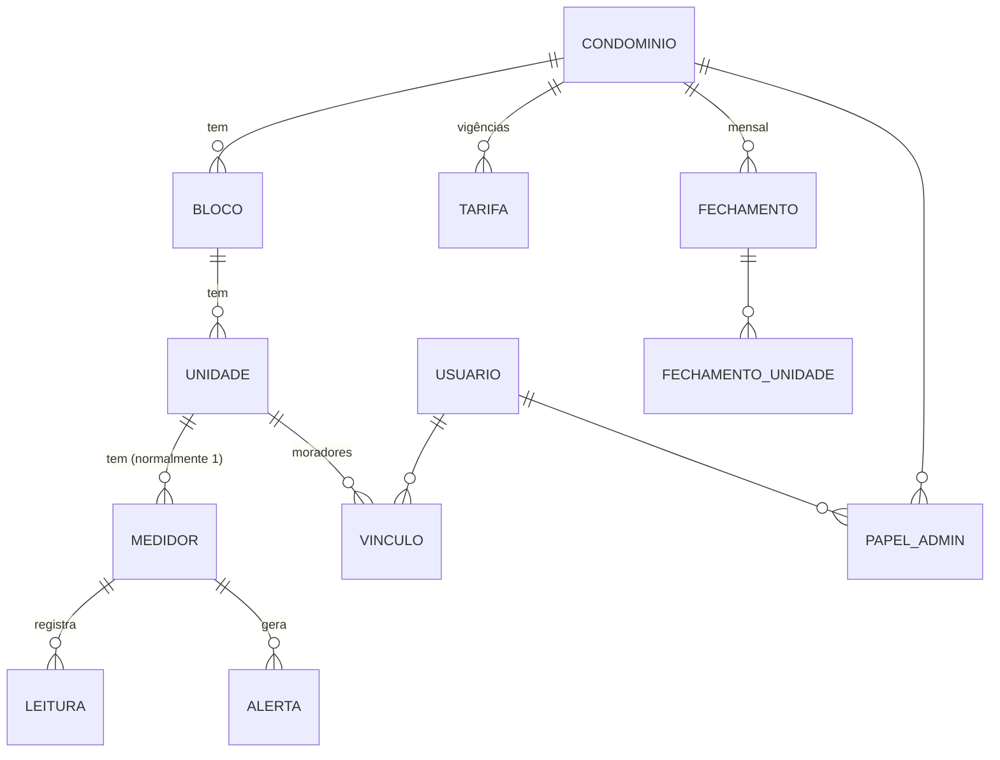
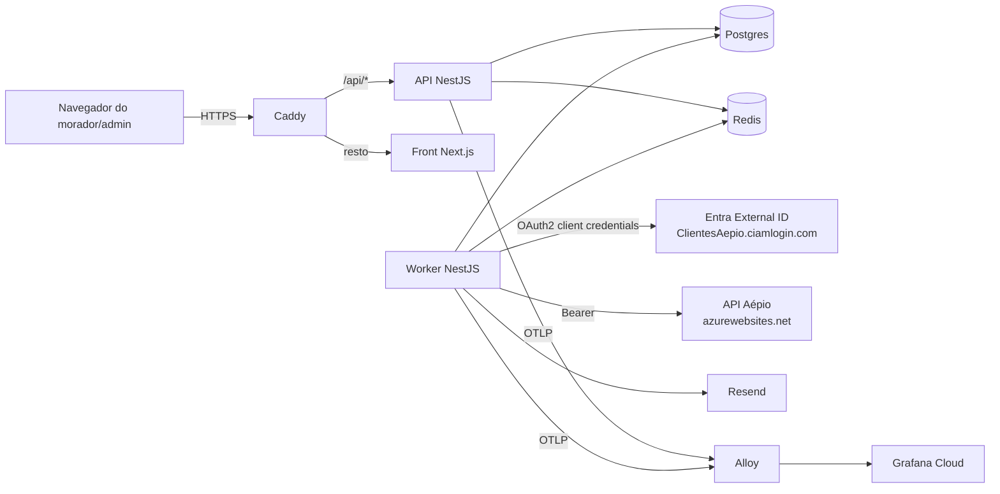

# Gás Individualizado — Especificação do projeto

> Versão 0.3 · 2026-10-10 · v0.3 registra a DEC-007 (aplicação agnóstica da Aépio) e acompanha a primeira implementação (fases 0 e 1 sem observabilidade) · status: **para revisão do João Pedro**
>
> Escrita no mesmo formato do coda: regras de negócio (**RN-\***), casos de uso (**UC-\***),
> decisões (**DEC-\*** de produto, **ADR-\*** técnicas) e questões em aberto (**QA-\***).
> Tudo marcado como *revisável* é um padrão assumido para não travar, não uma decisão fechada.

---

## 1. Visão do produto

Em condomínios com gás GLP central, o consumo costuma ser rateado por fração ideal ou por
leitura manual de medidor. O **Gás Individualizado** mostra a cada morador **quanto gás a sua
unidade consumiu**, quase em tempo real, e dá à administração o **fechamento mensal por
unidade** pronto para cobrança.

A medição vem de sensores da **Aépio** instalados nos medidores de cada unidade. O sensor
alimenta a base da Aépio, que expõe os dados por uma API (OAuth 2.0). O nosso sistema
**importa** essas leituras, guarda o histórico, calcula consumo e custo, e apresenta tudo por
perfil de usuário.

### Objetivos

1. O morador vê o consumo da sua unidade (hoje, semana, mês, histórico) e uma estimativa de custo.
2. O admin vê todas as unidades, fecha o mês e exporta o rateio para a cobrança.
3. O sistema avisa quando algo está errado: consumo anormal (possível vazamento) e sensor sem
   comunicação.

### Fora do escopo do MVP

- Cobrança/pagamento dentro do sistema (boleto, Pix). O MVP **exporta** os valores; quem cobra é
  a administradora. (*Revisável, ver QA-05.*)
- Corte remoto de gás ou qualquer comando ao equipamento: o sistema é **somente leitura** sobre a
  API da Aépio.
- App nativo. O front é web **mobile-first** (mesmo padrão do coda), instalável como PWA.

---

## 2. Glossário

| Termo | Significado |
| --- | --- |
| **Condomínio** | O prédio/conjunto atendido. Unidade de isolamento dos dados (tenant). |
| **Bloco** | Torre ou bloco dentro do condomínio (opcional; condomínio de um bloco só tem um bloco implícito). |
| **Unidade** | Apartamento/sala. É a quem o consumo pertence. |
| **Medidor** | Medidor de gás físico de uma unidade, com o sensor Aépio acoplado. Identificado pelo id que a API da Aépio usar. |
| **Leitura** | Valor **acumulado** do medidor (m³) num instante, como vem da Aépio. |
| **Consumo** | Diferença entre duas leituras do mesmo medidor, num intervalo. |
| **Fator de conversão** | m³ → kg de GLP, configurado por condomínio (a distribuidora fatura em kg ou m³). |
| **Tarifa** | Preço do gás (R$/kg ou R$/m³) vigente num período, por condomínio. |
| **Fechamento** | Consolidação mensal: leitura inicial, final, consumo e valor por unidade. Depois de fechado, não muda. |
| **Morador** | Usuário vinculado a uma ou mais unidades. Vê só as suas. |
| **Admin** | Usuário que administra um condomínio (síndico, administradora, zelador autorizado). Vê todas as unidades daquele condomínio. |
| **Operador** | Dono da plataforma (você). Cadastra condomínios e admins. É um admin com escopo global. |

---

## 3. Modelo de domínio



- Um **usuário** pode ser morador de várias unidades (ex.: dono de dois apartamentos) e admin de
  vários condomínios (ex.: administradora). Os papéis são **por condomínio**, não globais.
- A **troca de morador** (mudança, venda) encerra o vínculo com data; o novo morador só vê o
  consumo **a partir da data do seu vínculo** (RN-012).
- A **troca de medidor** (manutenção) encerra um medidor e abre outro na mesma unidade; o
  consumo da unidade soma os dois sem salto (RN-104).

---

## 4. Regras de negócio

Faixas: **0xx** conta e acesso · **1xx** medição e consumo · **2xx** tarifa e fechamento ·
**3xx** alertas · **4xx** integração Aépio.

### Conta e acesso (RN-001 a RN-019)

**RN-001 — Login por e-mail e senha.** Mesmo modelo do coda: e-mail único, senha mínima de 8
caracteres com hash argon2id, verificação de e-mail, recuperação e troca de senha.

**RN-002 — Sem cadastro aberto.** Ninguém se cadastra sozinho. O morador entra por **convite**
enviado pelo admin para uma unidade; o admin entra por convite do operador. O link de convite
expira em 7 dias e é de uso único. *Por quê:* o vínculo morador↔unidade é o que protege o dado
de consumo; deixá-lo ao usuário abriria a porta para alguém ver a unidade do vizinho.

**RN-003 — Dois papéis por condomínio.** `morador` (por unidade) e `admin` (por condomínio).
Além deles, o `operador` da plataforma tem acesso a todos os condomínios. *(DEC-001)*

**RN-004 — Isolamento.** Toda consulta é filtrada pelo condomínio e, para o morador, pelas
unidades vinculadas a ele. Um morador nunca vê consumo individual de outra unidade.

**RN-005 — Comparação anônima.** O morador pode ver a **média** de consumo das unidades do
condomínio (e a sua posição em faixa: abaixo/na média/acima), nunca dados de outra unidade
identificada. A média só aparece com **5 ou mais unidades** com dado no período, para não
permitir dedução. *(Revisável.)*

**RN-010 — Vínculo com vigência.** O vínculo morador↔unidade tem `inicio` e `fim` (opcional).
**RN-012 —** O morador vê o consumo apenas dentro da vigência do seu vínculo.

**RN-015 — LGPD.** Consumo por unidade é dado pessoal (revela hábitos e presença em casa). O
morador pode exportar seus dados; ao sair, o vínculo é encerrado, mas as leituras pertencem à
unidade e ficam (são necessárias ao fechamento). Retenção das leituras brutas: 5 anos
*(revisável, ver QA-07)*.

### Medição e consumo (RN-100 a RN-119)

**RN-100 — Leitura acumulada é a fonte da verdade.** Guardamos a leitura acumulada como veio da
Aépio. Consumo é sempre **derivado** (diferença de leituras), nunca recebido pronto. *Por quê:*
uma leitura perdida não perde consumo; ele aparece inteiro no intervalo seguinte.
*(Se a API entregar só consumo por intervalo, esta regra muda: ver QA-01.)*

**RN-101 — Idempotência.** Uma leitura é única por `(medidor, instante)`. Reimportar o mesmo
período não duplica nada.

**RN-102 — Leitura menor que a anterior.** Indica troca de medidor, virada do contador ou erro.
A leitura é guardada, marcada como **anômala**, não gera consumo negativo e abre um alerta de
saúde para o admin (RN-302).

**RN-103 — Unidade de exibição.** O consumo é calculado em m³ e exibido em **m³ e kg** (pelo
fator de conversão do condomínio). Valores em R$ usam a tarifa vigente (RN-200).

**RN-104 — Troca de medidor.** O consumo da unidade é a soma dos consumos de cada medidor no seu
período ativo; a leitura inicial do medidor novo não conta como consumo.

**RN-105 — Agregações.** O sistema mantém consumo por **hora** e por **dia** por unidade,
calculado a partir das leituras, para as telas não varrerem leituras brutas. O dia fecha à
meia-noite de `America/Sao_Paulo`.

### Tarifa e fechamento (RN-200 a RN-219)

**RN-200 — Tarifa com vigência.** O admin cadastra o preço (R$/kg ou R$/m³) com data de início.
Uma tarifa nova não altera meses já fechados.

**RN-201 — Fator de conversão por condomínio.** m³ → kg configurável (padrão sugerido
**2,3 kg/m³**, a confirmar com a distribuidora do condomínio, ver QA-04).

**RN-202 — Estimativa do mês corrente.** Durante o mês, o morador vê "consumo até agora" e
"estimativa de valor", sempre rotulada como estimativa.

**RN-203 — Fechamento mensal.** O admin escolhe o dia de corte (padrão: último dia do mês,
23:59). No fechamento, para cada unidade, fixam-se leitura inicial, leitura final, consumo,
tarifa aplicada e valor. **Fechado não muda**; correção posterior vira um **ajuste** lançado no
mês seguinte, com motivo.

**RN-204 — Unidade sem leitura no corte.** Se um medidor não comunicou no dia do corte, usa-se a
última leitura disponível e a unidade sai marcada "leitura estimada" no fechamento; a diferença
entra naturalmente no mês seguinte (consequência da RN-100).

**RN-205 — Exportação.** O fechamento exporta em **CSV** e **PDF** (um resumo geral e um
demonstrativo por unidade), para a administradora lançar na cobrança.

**RN-206 — Consumo das áreas comuns.** Se houver medidor de área comum (salão, churrasqueira),
ele é uma unidade do tipo `area_comum`, aparece no fechamento e não tem morador. Como ratear esse
consumo é decisão do condomínio (QA-06); o MVP só o exibe.

### Alertas (RN-300 a RN-319)

**RN-300 — Vazamento e consumo anormal: o alarme do próprio dispositivo vem primeiro.** O DLA NB
já gera alarmes de **vazamento, consumo anormal, fraude e bateria** (seção 8.1). Todo alarme que
chegar pela API vira alerta no sistema: vazamento e consumo anormal para morador e admin; fraude e
bateria só para o admin.

**RN-300a — Regra própria de consumo contínuo (complementar).** Além do alarme do equipamento, se
uma unidade tiver consumo em **todas as horas** de uma janela de **6 horas** *(revisável)*, gera
alerta. *Por quê:* uso doméstico normal tem pausas; fluxo ininterrupto é o sinal clássico de
vazamento. **Limitação:** como o dispositivo transmite uma vez por dia (seção 8.1), esta regra só
detecta o problema **depois** da transmissão, com até ~24 horas de atraso. Ela não substitui o
alarme do equipamento nem detector de gás no apartamento.

**RN-301 — Consumo acima do normal.** Consumo diário maior que **3×** a média diária da própria
unidade nos 30 dias anteriores gera alerta para o morador. *(Revisável.)*

**RN-302 — Sensor mudo.** Medidor sem transmissão nova há **36 horas** (uma transmissão diária
perdida mais folga) gera alerta para o admin (não para o morador). Volta ao normal sozinho na
próxima leitura. Bateria baixa (tensão informada pelo dispositivo) também gera alerta de saúde.

**RN-303 — Canais.** MVP: alerta na tela e por **e-mail** (Resend). Push/WhatsApp ficam para
depois (QA-08). Um alerta do mesmo tipo e unidade não se repete por e-mail em menos de 24 horas.

### Integração Aépio (RN-400 a RN-419)

**RN-400 — Somente leitura.** O sistema só consome a API da Aépio; nunca escreve nela.

**RN-401 — Autenticação.** OAuth 2.0 *client credentials* no Microsoft Entra External ID
(detalhes na seção 8). Um token por processo, reaproveitado até perto de expirar.

**RN-402 — Sincronização periódica.** O dispositivo grava leituras **de hora em hora** e as
transmite em lote **uma vez a cada 24 horas** (configurável no equipamento, seção 8.1). Cada
medidor transmite num horário diferente, então o worker consulta a API **a cada 1 hora**
*(revisável)*, a partir do último instante já importado por medidor, com sobreposição de 24 horas
para pegar lotes atrasados (a RN-101 descarta repetidas).

**RN-402a — O que o morador vê é "até a última transmissão".** O painel nunca diz "agora": mostra
o consumo até a última leitura recebida, com a data e hora dela ("dados até ontem, 14h"). Se o
condomínio quiser mais frescor, pode pedir à Aépio para reduzir o intervalo de transmissão, ao
custo de bateria (QA-02).

**RN-403 — Respeito à API.** Taxa limitada por limiter da fila (padrão 2 req/s, ajustável) e
backoff exponencial em erro 429/5xx. Falha persistente da Aépio gera alerta de saúde para o
operador, não para moradores.

**RN-405 — Conferência com o mostrador.** O DLA é parametrizado com a leitura do mostrador
mecânico na instalação. O admin pode lançar uma **leitura manual** (foto + valor) de qualquer
medidor; se ela divergir da última leitura da Aépio em mais de 0,1 m³ *(revisável)*, abre-se
um alerta de saúde para conferência. Leitura manual não gera consumo; serve só para auditoria.

**RN-406 — Plano B de importação.** A plataforma da Aépio exporta **CSV/TXT**. Se a API atrasar
ou cair, o admin pode subir esse arquivo e o sistema importa as leituras pelas mesmas regras
(RN-101 garante que nada duplica).

**RN-404 — Mapeamento de medidores.** O admin (ou operador) associa cada medidor da Aépio a uma
unidade. Medidor que aparece na API e não está associado fica numa lista "não vinculados" e suas
leituras são guardadas mesmo assim, para não perder histórico.

---

## 5. Casos de uso

| UC | Ator | Descrição |
| --- | --- | --- |
| UC-01 | Morador | Aceitar convite, criar senha e entrar. |
| UC-02 | Morador | Ver o painel: consumo de hoje, do mês até agora, estimativa em R$, gráfico dos últimos 30 dias, comparação com a média (RN-005). |
| UC-03 | Morador | Ver histórico: consumo por hora/dia/mês em gráfico e tabela, escolhendo período. |
| UC-04 | Morador | Ver os fechamentos dos meses anteriores da sua unidade e baixar o demonstrativo em PDF. |
| UC-05 | Morador | Receber e consultar alertas (vazamento suspeito, consumo alto). |
| UC-06 | Morador | Alternar entre unidades, se tiver mais de uma. |
| UC-07 | Morador | Exportar seus dados e editar perfil (LGPD). |
| UC-10 | Admin | Cadastrar blocos e unidades (manual ou importando CSV). |
| UC-11 | Admin | Convidar moradores para unidades, encerrar vínculos. |
| UC-12 | Admin | Vincular medidores Aépio às unidades; trocar medidor. |
| UC-13 | Admin | Ver painel do condomínio: consumo total, ranking de unidades, unidades sem comunicação, alertas abertos. |
| UC-14 | Admin | Cadastrar tarifa e fator de conversão. |
| UC-15 | Admin | Fazer o fechamento do mês, revisar, confirmar e exportar CSV/PDF. |
| UC-16 | Admin | Lançar ajuste com motivo em mês fechado. |
| UC-17 | Admin | Convidar outros admins do mesmo condomínio. |
| UC-20 | Operador | Cadastrar condomínio e as credenciais Aépio dele; convidar o primeiro admin. |
| UC-21 | Operador | Ver saúde da integração (última sincronização, erros, medidores mudos) de todos os condomínios. |
| UC-22 | Sistema | Sincronizar leituras da Aépio (RN-402). |
| UC-23 | Sistema | Recalcular agregados horários/diários a cada leitura nova (RN-105). |
| UC-24 | Sistema | Avaliar regras de alerta (RN-300 a RN-302). |

### Telas (mobile-first)

- **Morador:** Painel · Histórico · Fechamentos · Alertas · Perfil.
- **Admin:** Painel do condomínio · Unidades · Moradores · Medidores · Tarifas · Fechamentos ·
  Alertas · Admins.
- **Operador:** Condomínios · Saúde da integração.

---

## 6. Decisões de produto

| DEC | Decisão | Status |
| --- | --- | --- |
| DEC-001 | Papéis `morador` e `admin` por condomínio, mais `operador` global. (Pedido do João Pedro: "usuários e admins".) | ✅ Aceita |
| DEC-002 | Cadastro só por convite (RN-002). | 🟡 Revisável |
| DEC-003 | Multi-condomínio no modelo desde o início, mesmo que o MVP rode um só. Custa pouco agora e evita migração depois. | 🟡 Revisável |
| DEC-004 | Leitura acumulada como fonte da verdade, consumo derivado (RN-100). | 🟡 Depende da QA-01 |
| DEC-005 | Fechado não muda; correção vira ajuste no mês seguinte (RN-203). | 🟡 Revisável |
| DEC-006 | Sem cobrança no sistema no MVP; só exportação. | 🟡 Revisável |
| DEC-007 | A aplicação é agnóstica da integração: a API da Aépio é tratada como caixa-preta, nossos campos e estruturas são os da aplicação, e um adaptador (mapper) traduz quando os endpoints chegarem. Até lá, uma fonte simulada determinística alimenta telas e testes. (Pedido do João Pedro em 10/10/2026.) | ✅ Aceita |

---

## 7. Arquitetura técnica (mesmo padrão do coda)

Tudo abaixo replica o que o coda já usa e já roda na VPS, para manter um só jeito de
desenvolver, publicar e operar os projetos.

### 7.1 Stack

| Camada | Tecnologia | Origem no coda |
| --- | --- | --- |
| Monorepo | pnpm workspaces (pnpm 11, sempre `pnpm` direto) + Turborepo, TypeScript, Node ≥ 22 | ADR-001 |
| Backend | NestJS: **API HTTP** + **worker** standalone, compartilhando módulos de domínio | ADR-002, ADR-004 |
| API | REST + OpenAPI (`@nestjs/swagger` em `/docs`), class-validator, helmet, `@nestjs/throttler` | ADR-004 |
| Banco | PostgreSQL 18 (PKs `uuidv7()`, `timestamptz`), Drizzle ORM com `postgres.js` | ADR-005, ADR-006 |
| Fila | Redis 7 + BullMQ (limiter por fila, jobs repetíveis) | ADR-010 |
| Auth | Passport (local + bearer), sessão opaca no banco, cookie httpOnly, argon2id | ADR-007, ADR-016 |
| Front | Next.js (App Router, `standalone`) + Tailwind + shadcn/ui + Radix + lucide-react, mobile-first | ADR-003, ADR-020 |
| E-mail | Resend (convites, recuperação de senha, alertas) | ADR-011 |
| Observabilidade | OpenTelemetry → Grafana Alloy → Grafana Cloud; Sentry só para erros | ADR-017/018/019 |
| Testes | Vitest (unidade + integração com Postgres real) e **API Aépio dublada** | ADR-025 |
| CI/CD | GitHub Actions: CI (build + testes) → deploy por `workflow_run` → imagens no GHCR → SSH na VPS | ADR-021, ADR-026 |
| Infra | VPS única, Docker Compose, Caddy com HTTPS automático, front e API na mesma origem | ADR-008, ADR-026 |

### 7.2 Estrutura do repositório

```
packages/
  types/          @gas/types          tipos de domínio compartilhados
  db/             @gas/db             schema Drizzle + migrations + client
  core/           @gas/core           módulos NestJS: identidade, condomínio, medição,
                                       consumo, tarifa-fechamento, alertas, aepio
  observability/  @gas/observability  bootstrap OTel + Sentry
apps/
  api/            @gas/api            entrypoint HTTP + OpenAPI
  worker/         @gas/worker         Nest standalone consumindo BullMQ
  front/          —                   Next.js
docs/             produto (RN, UC, DEC, QA)
docs-tec/         técnico (arquitetura, dados, ADR, HANDOFF)
```

Nome do repositório sugerido: `jpmvale/gas-individualizado` (não criado ainda).

### 7.3 Visão de componentes



A API nunca chama a Aépio diretamente: **só o worker** fala com ela (mesmo princípio da ADR-009
do coda com a MusicBrainz). Isso concentra token, limite de taxa e retentativas num lugar só, e
o morador nunca espera a Aépio para abrir o painel.

### 7.4 Filas e jobs do worker

| Fila / job | O que faz | Frequência |
| --- | --- | --- |
| `aepio-sync` (repetível) | Para cada condomínio ativo, enfileira a busca de leituras e alarmes desde o último instante importado (−24 h). | 1 h |
| `aepio-fetch` | Chama a API, grava leituras (`ON CONFLICT DO NOTHING`), atualiza cursor por medidor. Limiter de 2 req/s. | sob demanda |
| `consumo-agregar` | Recalcula agregados hora/dia das unidades afetadas pelas leituras novas. | após cada `aepio-fetch` |
| `alertas-avaliar` | Avalia RN-300 a RN-302 e envia e-mails. | após agregação + varredura horária para "sensor mudo" |
| `fechamento-gerar` | Monta o rascunho de fechamento no dia de corte para o admin revisar. | mensal |

### 7.5 Modelo de dados (resumo)

```sql
condominio      (id, nome, fuso, fator_m3_kg numeric, dia_corte, aepio_client_id,
                 aepio_secret_ref, ativo, created_at, updated_at)
bloco           (id, condominio_id, nome)
unidade         (id, bloco_id, identificacao, tipo 'residencial'|'area_comum')
medidor         (id, unidade_id NULL, aepio_id UNIQUE, inicio, fim NULL)
leitura         (medidor_id, instante timestamptz, valor_m3 numeric(14,4),
                 anomala bool, importada_em, PRIMARY KEY (medidor_id, instante))
consumo_hora    (unidade_id, hora timestamptz, m3 numeric, PRIMARY KEY (unidade_id, hora))
consumo_dia     (unidade_id, dia date, m3 numeric, PRIMARY KEY (unidade_id, dia))
usuario, sessao, token_verificacao     -- iguais ao coda (doc 05)
vinculo         (id, usuario_id, unidade_id, inicio, fim NULL)
papel_admin     (usuario_id, condominio_id, PRIMARY KEY (usuario_id, condominio_id))
convite         (id, email, tipo 'morador'|'admin', alvo_id, token_hash, expira_em, usado_em)
tarifa          (id, condominio_id, unidade_preco 'kg'|'m3', preco numeric, vigente_desde date)
fechamento      (id, condominio_id, competencia date, corte timestamptz,
                 status 'rascunho'|'fechado', tarifa_id, fechado_por, fechado_em)
fechamento_unidade (fechamento_id, unidade_id, leitura_ini, leitura_fim, m3, kg, valor,
                    estimada bool, ajuste numeric, ajuste_motivo)
alerta          (id, unidade_id NULL, medidor_id NULL, tipo, aberto_em, resolvido_em, notificado_em)
aepio_cursor    (medidor_id PRIMARY KEY, ultimo_instante)
```

Volume esperado: com uma leitura por hora (seção 8.1), **8.760 linhas por medidor por ano**; um
prédio de 100 unidades dá menos de 1 milhão por ano. Postgres comum aguenta bem com o índice da PK. Se
crescer muito (muitos condomínios ou leitura por minuto), particionar `leitura` por mês; não é
preciso no MVP. *(ADR-G03)*

### 7.6 Autorização

Uma guarda NestJS resolve, a cada requisição, as unidades e condomínios do usuário (vínculos
vigentes e `papel_admin`) e filtra toda consulta por eles (RN-004). Rotas de admin exigem
`papel_admin` no condomínio da rota; rotas de operador exigem a flag `operador` no usuário. É a
principal diferença para o coda, que não tem papéis (DEC-020 de lá).

### 7.7 Deploy e operação

Igual ao coda:

- `docker-compose.yml` (postgres, redis, alloy, migrate, api, worker) + `docker-compose.prod.yml`
  (front + caddy). Uma imagem de backend para `migrate`, `api` e `worker`, mudando só o comando.
- CI no push/PR; o workflow `deploy` dispara depois do CI verde em `main`, publica
  `ghcr.io/jpmvale/gas-individualizado-api` e `-front` com a tag do sha e chama
  `ssh deploy@VPS "gas-individualizado <sha>"` (forced command), com as mesmas 3 tentativas.
- Segredos de produção (`VPS_DEPLOY_KEY`, `VPS_HOST`, `GHCR_TOKEN`, credenciais Aépio, Resend,
  Grafana, Sentry) como secrets do GitHub e `.env` na VPS. As credenciais Aépio **nunca** vão para
  o repositório nem para o front.
- Domínio sugerido: `gas.imp-software.cloud` (o coda está em `coda.imp-software.cloud`).
- Backup: `pg_dump` diário dos dados (leituras, fechamentos, usuários) para bucket R2 **privado**,
  no mesmo esquema do `db:snapshot:user` do coda.

---

## 8. Integração com a Aépio (o que a documentação recebida cobre)

O PDF `Arquitetura_Autenticacao_API_Aepio-Prod.pdf` descreve **apenas a autenticação**:

| Item | Valor |
| --- | --- |
| Padrão | OAuth 2.0, fluxo *client credentials*, Microsoft Entra External ID |
| Token | `POST https://ClientesAepio.ciamlogin.com/6fa1e093-5dbd-4049-924b-7f249e987906/oauth2/v2.0/token` |
| Corpo | `application/x-www-form-urlencoded`: `grant_type=client_credentials`, `client_id`, `client_secret`, `scope=api://7358f95d-947f-4e7b-a954-da59ed9290a4/.default` |
| Resposta | `access_token` (JWT), `expires_in: 3600`, `token_type: Bearer` |
| Validade | 60 minutos; ao expirar, pedir outro token |
| URL base | `https://app-aepioiot-clientes-1-bsdfg5g9btfug2br.centralus-01.azurewebsites.net/{Endpoints}` |
| Header | `Authorization: Bearer {access_token}` |
| Credenciais | Fornecidas pelo time Aépio |
| Endpoints | **Não documentados ainda.** O PDF diz que haverá um portal de documentação "quando disponível". |

### 8.1 O que o site da Aépio diz sobre o equipamento

Pesquisado em aepio.com.br em 2026-10-10. A Aépio fabrica medidores de gás (Gravataí/RS) e oferece
dois dispositivos de leitura remota para os medidores residenciais de diafragma G1.0, G1.6 e G2.5,
que servem para GLP e têm aprovação INMETRO (Portaria 223/2018). Esses medidores já vêm
"pré-equipados para módulo de comunicação remota".

| Item | DLA NB (gás) | DLA (LoRa) |
| --- | --- | --- |
| Rede | Celular **NB-IoT** (também LTE-M), bandas B1/B3/B28, sem gateway | **LoRaWAN** 915 MHz (AU915), rede pública ou privada, precisa de gateway |
| Transmissão | **1 vez a cada 24 h, configurável** | 1 vez a cada 24 h |
| Registro | **Leituras de hora em hora** | Não informado |
| Dados enviados | Volume acumulado, histórico de consumo por hora, tensão da bateria, status de comunicação, alarmes | Volume acumulado, tensão da bateria, qualidade do sinal |
| Alarmes | Fraude, bateria, vazamento, consumo anormal (gatilhos não informados) | Não informados |
| Bateria | Lítio 3,6 V + supercapacitor, até 10 anos | Lítio 3,6 V, 10 anos |
| Integração | "Plataforma Aépio", "APIs para qualquer sistema", exporta .csv e .txt | Portal web, exporta CSV |
| Instalação | Sem desmontar o medidor; parametrizado com a leitura atual do mostrador; configuração por app e porta óptica | Igual |
| Certificação | ATEX (atmosfera explosiva), IP65, -25 °C a +55 °C, Anatel | ATEX, IP65, Anatel |

Fontes: [página do DLA NB Gás](https://www.aepio.com.br/site/dispositivo-de-leitura-aepio-dla-nb-gas/)
e [catálogo em PDF](https://www.aepio.com.br/site/wp-content/uploads/2026/05/Dispositivo_de_leitura_Aeio_DLA_NB_Gas.pdf);
[página do DLA](https://www.aepio.com.br/site/dla/) e [manual em PDF](https://www.aepio.com.br/site/wp-content/uploads/2024/06/AEPIO_DLA_Manual.pdf);
[medidor de diafragma](https://www.aepio.com.br/site/medidor-de-diafragma-aepio/). Existe também o
**medidor Smart-NB**, com corte remoto, mas a página dele não abriu.

**O que isso muda na especificação:**

1. **Volume acumulado confirmado** nos dois dispositivos, o que sustenta a RN-100.
2. **Não é tempo real.** O lote de 24 leituras horárias chega uma vez por dia. O painel mostra
   "dados até a última transmissão" (RN-402a) e o worker consulta a API de hora em hora (RN-402).
3. **Os alarmes do equipamento** (vazamento, consumo anormal, fraude, bateria) passam a ser a fonte
   principal de alerta (RN-300). Nossa regra de consumo contínuo fica como complemento.
4. **Saúde do sensor:** guardar tensão da bateria e status de comunicação por medidor; o alerta de
   sensor mudo passa a 36 horas (RN-302).
5. **Plano B por CSV/TXT** (RN-406) e **conferência com o mostrador** (RN-405).
6. O site não documenta os endpoints. Continua valendo a QA-01.

### 8.2 Desenho do adaptador

Mesmo padrão de portas do coda (`ports/*.port.ts` + `*.http.ts`):

```ts
// packages/core/src/modules/aepio/aepio.port.ts
export interface AepioPort {
  listarMedidores(): Promise<MedidorAepio[]>;
  leiturasDesde(aepioId: string, desde: Date): Promise<LeituraAepio[]>;
}
```

- `aepio.token.ts` guarda o token em memória e renova quando faltarem menos de 5 min para
  expirar, ou ao receber 401 (uma única nova tentativa).
- `aepio.http.ts` implementa a porta quando os endpoints forem conhecidos. Até lá, existe só o
  **dublê** (`aepio.fake.ts`) que gera leituras realistas, o que permite construir e testar o
  sistema inteiro sem a API real (mesma estratégia da MusicBrainz falsa no coda).
- Credenciais por condomínio (`aepio_client_id` + segredo em variável de ambiente referenciada
  por `aepio_secret_ref`), caso cada condomínio tenha o seu contrato. Se for uma credencial única
  da plataforma, vira uma variável só (QA-03).

---

## 9. Questões em aberto

| QA | Pergunta | Por que importa | Padrão assumido |
| --- | --- | --- | --- |
| **QA-01** | Quais endpoints a API da Aépio expõe e em que formato? *(O site confirma que o dispositivo envia volume acumulado e histórico horário, mas não documenta a API.)* | Define o adaptador. É o maior bloqueio para ligar dados reais. | Leitura acumulada em m³ por hora, com timestamp; desenvolvimento segue com o dublê. |
| **QA-02** | ~~Com que frequência o sensor envia leituras?~~ **Respondida pelo site:** registra de hora em hora e transmite a cada 24 h, configurável. Resta saber: o condomínio quer pedir intervalo menor, aceitando gastar mais bateria? | Frescor do painel e tempo de reação a vazamento. | Manter 24 h. |
| **QA-11** | Qual dispositivo será comprado: **DLA NB** (celular, sem gateway) ou **DLA LoRa** (precisa de gateway)? | O DLA NB tem histórico horário e alarmes de vazamento; no DLA LoRa o site não cita nenhum dos dois. | DLA NB. |
| **QA-12** | Os alarmes de vazamento do DLA NB são enviados **na hora** (fora do ciclo de 24 h) ou só no lote diário? Quais os gatilhos? | Define se o sistema consegue avisar um vazamento a tempo de agir. | Só no lote diário (pior caso), até a Aépio confirmar. |
| **QA-03** | A credencial Aépio é uma por condomínio ou uma para a plataforma toda? | Modelo de dados e onde guardar segredo. | Suporta por condomínio. |
| **QA-04** | A distribuidora fatura em kg ou m³, e com que fator de conversão/correção? | Valor em R$ correto no fechamento. | Configurável; 2,3 kg/m³ de partida. |
| **QA-05** | O sistema deve um dia emitir cobrança (boleto/Pix) ou fica só no rateio exportado? | Escopo e integração com gateway. | Só exportação no MVP. |
| **QA-06** | Como ratear o consumo de áreas comuns? | Fechamento. | Só exibido no MVP. |
| **QA-07** | Por quanto tempo guardar leituras brutas? | LGPD e custo de banco. | 5 anos. |
| **QA-08** | Alertas por WhatsApp ou push além de e-mail? | Custo e integração. | Só tela + e-mail no MVP. |
| **QA-09** | ~~Na VPS, como os projetos compartilham as portas 80/443?~~ **Respondida pelo repo vps-infra:** um Caddy compartilhado com Caddyfile estático e a rede docker `edge`; nenhum app sobe proxy próprio. | Dois Caddy na mesma máquina não podem ocupar 80/443. | `gas.imp-software.cloud` entra como mais um bloco no Caddyfile compartilhado (ADR-G06). |
| **QA-10** | Quantos condomínios/unidades no início, e já existe o primeiro prédio piloto? | Dimensionamento e dados de teste. | 1 condomínio piloto. |

---

## 10. Plano de entrega

| Fase | Entrega | Depende de |
| --- | --- | --- |
| **0. Fundação** | Repositório no padrão coda: monorepo, compose, CI, deploy, observabilidade, auth com convites e papéis. | Aprovação desta spec |
| **1. Domínio sem a Aépio** | Condomínio, unidades, medidores, leituras vindas do **dublê**, agregados, painel do morador e do admin. | Fase 0 |
| **2. Fechamento e alertas** | Tarifas, fechamento mensal, exportação CSV/PDF, alertas por e-mail. | Fase 1 |
| **3. Aépio real** | Adaptador HTTP real, sincronização, mapeamento de medidores, tela de saúde da integração. | **QA-01**, credenciais Aépio |
| **4. Piloto** | Deploy em `gas.imp-software.cloud`, cadastro do prédio piloto, convites aos moradores. | QA-09, QA-10 |

As fases 0 a 2 não dependem da Aépio, então o desenvolvimento pode começar já, enquanto a
documentação dos endpoints não chega.
